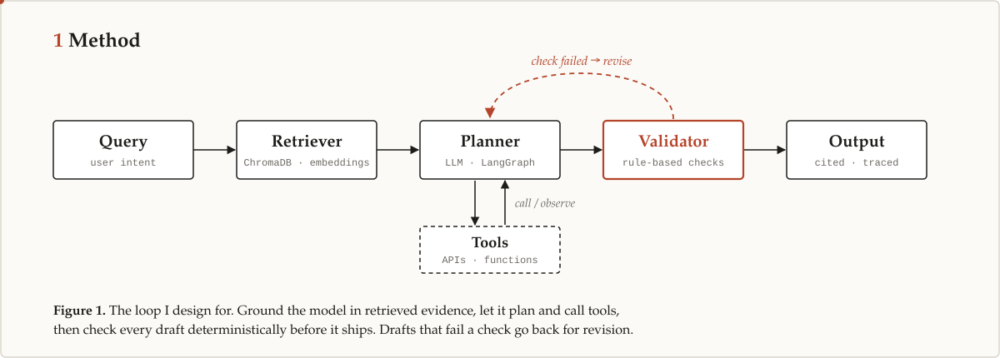
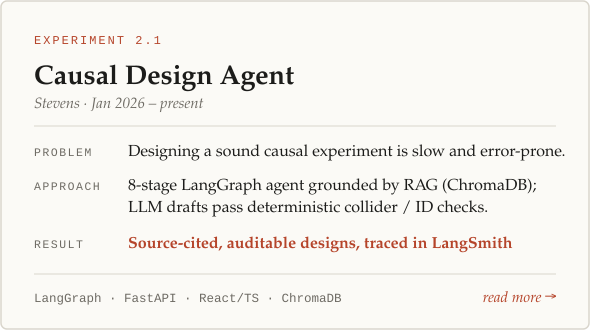
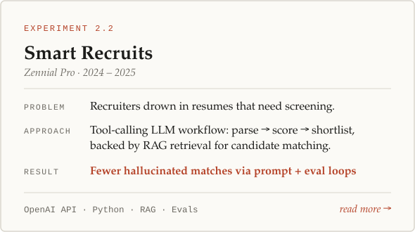
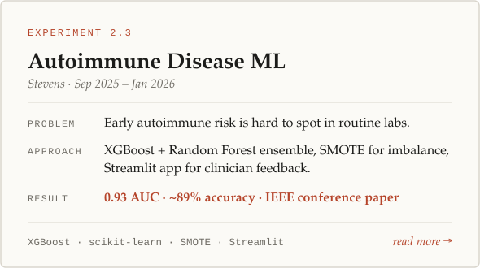
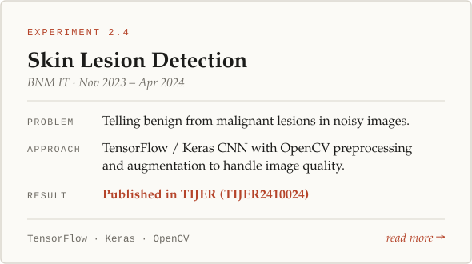
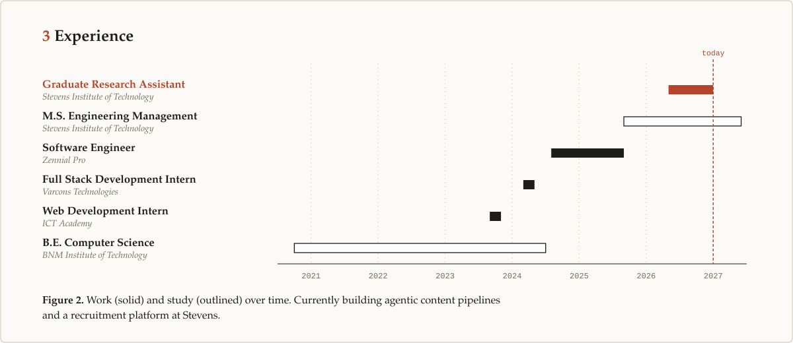
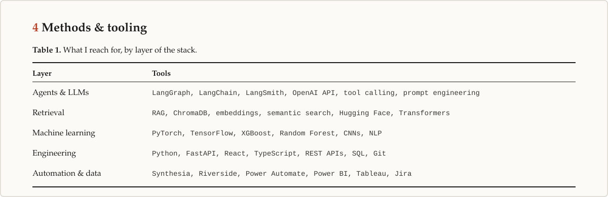
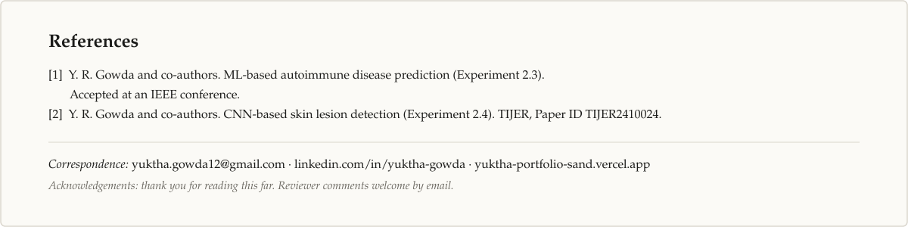

  <a href="https://yuktha-portfolio-sand.vercel.app/">portfolio</a> &nbsp;·&nbsp;
  <a href="https://linkedin.com/in/yuktha-gowda">linkedin</a> &nbsp;·&nbsp;
  <a href="mailto:yuktha.gowda12@gmail.com">email</a>

  
  
  
  

